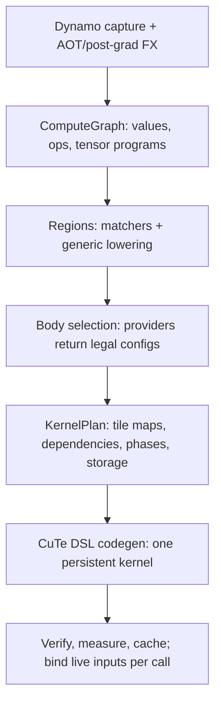

# MegaBake architecture

**Revised 2026-10-19. Sections 1–8 describe the compiler as built. Section 9 is the target design from the [2026-10-18 gap report](docs/research/2026-10-18-megakernel-gap/report.md). [ROADMAP.md](ROADMAP.md) has the measured state and the order of work. [north-star.md](north-star.md) fixes the scope.**

**Build a generic compiler that keeps fast device pipelines intact when it composes them into one kernel, and that wins where only one kernel can: tile-level dataflow, cross-op weight streaming, and work for idle SMs.**

## Principles

1. **The captured graph is the semantic reference.** Every fusion preserves guards, outputs, mutations, aliases and explicit casts.
2. **Generic by meaning, not by name.** Coverage comes from primitive families and declared ops. A named matcher (RMSNorm, RoPE) is an optimization; when it misses, generic lowering must still compile the graph.
3. **No model-keyed constants.** Tuning is keyed by device facts and problem shape, ranked by a cost model, and corrected by measurement. A constant fitted to one model or one GPU partition is a bug ([gap report §4](docs/research/2026-10-18-megakernel-gap/report.md#4-overfitting-confirmed)).
4. **A device body keeps its pipeline.** The outer compiler composes tuned GEMM and attention pipelines; it never flattens them into scalar code.
5. **Hand-written code holds only inner pipelines plus hook slots.** Norm variants, RoPE style, activations, biases and casts come from the graph and are compiled into hooks.
6. **Evidence decides.** A claim names the workload, shapes, precision, GPU, baseline and method. The baseline is the strongest equivalent one, including CUDA graphs.

## 1. Pipeline



| Stage | Module | What it does |
| --- | --- | --- |
| Capture | `frontend.py`, `fx_handler/` | `make_backend()`; pinned AOT, pre-grad and post-grad passes; capture cache; options `mode`, `fallback` |
| Declared ops | `fx_handler/hf_attention.py` | `megabake::attention` and `megabake::kv_attention` through transformers' `AttentionInterface`; `DecodeStep` for one-token decode over explicit KV state |
| Import | `graph.py` | `import_fx` into `ComputeGraph` (`Value`, `Op`, `Region`) |
| Lowering | `lowering.py` | Tensor programs per primitive family; `UnsupportedLowering` names the gap |
| Regions | `regions.py` | Semantic matchers (RMSNorm, RoPE, attention, gated MLP) and region formation |
| Bodies | `bodies/` | `interface.py` contracts; `gemm.py` Hopper TMA/WGMMA; `attention.py`; `generic.py` map, reduction and contraction; `blackwell.py` correctness baseline |
| Planning | `planner.py`, `plan.py` | Body selection, tile maps, bounded plan search |
| Scheduling | `schedule.py` | Dependencies, phase schedule, event schedule, simulation |
| Storage | `memory.py` | Lifetimes, workspace reuse, per-worker scratch, plan verification |
| Codegen | `codegen.py` | Table launch (device address table) or parameter launch |
| Runtime | `runtime.py` | Cooperative launch, counting grid barrier, events |
| Orchestration | `compiler.py`, `cache.py`, `buckets.py` | Compile, admit, bind; plan cache; size buckets |

## 2. The PyTorch contract

MegaBake receives live FX after the pinned AOT and post-grad passes, before Inductor lowering. It keeps PyTorch's wrappers for lifted arguments, output structure, guards and mutations, and binds current inputs and parameters on every call. Kernel arguments are constant between calls; a call packs nothing and does not block.

- **Modes.** `mode=prefill|decode` selects policy defaults and validates the captured state contract. It cannot create a KV cache or remove outputs; the graph decides the computation.
- **Declared ops.** Stateful and complex mixers enter as declared ops with a PyTorch reference, a fake implementation and a tuned body. Attention is declared for every HF model at once through `AttentionInterface`, so it is not recovered from decomposed ATen.
- **Fallback.** `fallback=error` (default) fails before any device work. `fallback=inductor` delegates the whole invocation and labels the result `inductor_fallback`. Partitioned execution is not supported.
- **Static shapes.** `megabake.bucketed` serves variable lengths through a few compiled sizes and raises `PaddingDependence` if padding could change real outputs.

## 3. Compute graph and lowering

The graph keeps every FX operation and its source location. Import rules give known operations a **tensor program**: output and reduction domains, indexed loads, predicates, typed scalar expressions with explicit casts, and stores.

| Family | Examples |
| --- | --- |
| Contraction | GEMM, 1-D convolution |
| Pointwise and cast | arithmetic, `exp2`, `erf`, rounding, logical, min/max, clamp |
| Reduction | sums, max, norms |
| View and copy | `select`, `squeeze`, `split`→`slice`, `unsqueeze` |
| Scatter and state | `select_scatter`, `slice_scatter`, `index_put`, `copy_`, KV writes |
| Padding | constant pad |
| Opaque | kept with a lowering reason; blocks device compilation |

Not yet lowered: scans (`cumsum`), triangular solve, reductions over several axes. Inductor reaches all of core ATen with about six IR kinds; extending the families, not adding per-op rules, is the route to coverage.

## 4. Device bodies

A provider receives a region's tensor program, its semantic parameters and `TargetFacts`, and returns legal `BodyConfig`s or a `ProviderRejection` with a reason. Each body declares its participants, scratch, barriers, completion points and resource use (`bodies/interface.py`).

| Family | Built today |
| --- | --- |
| Projection | Hopper TMA/WGMMA, 64x64x64, 8 stages. swapAB for launches with ≤ 64 rows (weight on WGMMA's M, tokens on N = 16/32/64). Bias epilogue. Deterministic split-K, off |
| Prefill attention | One warp per query row; keys in sequence |
| Decode attention | Split context across CTAs; chunks exchange max/sum; the last chunk merges in order |
| Norms, RoPE, activations, residuals | Generated map and reduction bodies; row-mode reductions |
| Fallback contraction | Generic indexed contraction (slow; correctness path) |
| Blackwell | `mma.sync` correctness baseline, not a performance provider |

A body processes a range of tiles while keeping its pipeline. Scratch is allocated per worker. TMA stores complete and fence before any barrier or event publishes their data.

## 5. Scheduling and launch

**Phases.** A phase is one dependency level of the plan. Persistent CTAs (one per SM) process tile ranges; a counting grid barrier (~0.7 µs at 60 CTAs) separates phases. Independent regions share a phase.

**Interval folding.** At decode sizes, small producers (norms, RoPE, elementwise) fold into their consumer's barrier interval: every CTA recomputes them instead of waiting at a barrier. A SmolLM layer costs about six barrier intervals instead of eleven. This is a megakernel-only trade: recompute is cheaper than a grid-wide wait.

**Two launch forms.**

| Launch | Used when | Synchronization |
| --- | --- | --- |
| Parameter launch | Small graphs; tensors and TMA descriptors as kernel parameters | Phases or events |
| Table launch | Parameters would exceed CUDA's 32 KB limit, which is every full model | **Phases only.** Tensors come from a device address table; TMA descriptors are written per phase in the prologue; all GEMMs share one shared-memory layout |

The event schedule exists (`make_event_schedule`, `make_region_event_schedule`, `publish_event`/`wait_for_event`) but is not yet emitted for table launches. Wiring it is ROADMAP step 1.

**Memory.** Distinct slices first; reuse only after all consumers, including async readers, finish. Phase lifetimes prove reuse cheaply; events need reachability or explicit release.

**Synchronization rules.** A producer finishes its writes and async operations, synchronizes its CTA, then publishes with release semantics. A consumer polls with acquire loads and synchronizes its CTA before reading. TMA and other proxy accesses need their extra fences.

## 6. Verification and numerics

- Explicit source casts are rounding points and are preserved (for example FP32 accumulation → bf16 result → FP32 activation → bf16).
- Plans must match eager within a global tolerance. A global tolerance cannot separate rounding from small bugs in a deep model, so when a plan misses it, **teacher-forced verification** decides:
  1. Rerun the same kernel with every intermediate in its own workspace slice. Outputs must match the normal run bit for bit; this catches reuse and race bugs.
  2. Every region must reproduce PyTorch on the inputs the candidate produced itself, within 1% relative L2. GEMM accumulation-order noise is about 3e-4.
- `tools/diff_intermediates.py` and `tools/dump_megakernels.py` locate failures.

## 7. Latency budget

```text
savings = launches removed + traffic avoided + useful overlap
costs   = body slowdown + dispatch + synchronization + layout conversion + spills + lost parallelism
```

Against CUDA-graph replay, launches removed are worth about 0.25 µs per kernel. The savings must come from avoided traffic, overlap, and idle-SM work. If GEMMs are 90% of the baseline and become 20% slower, the workload loses even if everything else disappears. Measure the complete workload; added isolated timings are a diagnostic only.

## 8. Search and caching as built

`search_plans` enumerates body selections under a `SearchBudget` and measures candidates. **For table launches, `compile_plan` forces `max_plans=1`,** so every full model runs its greedy seed plan unmeasured. The plan cache (`make_plan_key`) keys on the selected plan, the prepared graph hash, input specs, mode, scheduler, toolchain versions and, when given, body revisions. Weights are runtime data bound by reference to the user's tensors; MegaBake owns no derived weights.

## 9. Target design

The target keeps the frontend and the persistent runtime and adds five parts.

1. **Mega bodies with hook slots.** A small, model-agnostic library: GEMM, attention, split-KV decode attention, row reduction, scan, grouped GEMM. Each has typed prologue and epilogue slots, for example RMSNorm as a row-scale prologue, residual add, SiLU·mul from a paired gate/up GEMM, RoPE in the load prologue, and a q-norm folded into the softmax scale.
2. **A contract matcher.** It absorbs neighbouring ops into those slots as expressions. RoPE style, norm variant and eps, activation, bias and casts come from the graph, matched by scalar-expression normal form rather than by ATen spelling.
3. **Layout assignment over typed edge formats.** `EdgeFormat` = dtype + scale spec + data layout + scale layout. Bodies declare ranked input and output alternatives; the planner assigns them with a bytes-plus-phases cost.
4. **`transform_params`.** A bake-time stage that owns derived weights (fused QKV, paired gate/up, layout permutations), proves that each transform commutes with the computation, detects changes to the source weights, and adds a transform revision to the cache key. Permuting a producer's output rows is bit-exact; permuting a consumer's reduction columns or folding a norm weight is not and needs an opt-in numerics policy.
5. **An event and prefetch scheduler.** Per-phase or per-tile completion counters replace grid barriers. CTAs that wait or have no work prefetch the next weights into L2, later into shared memory with persistent pipeline state. Static assignment only; dynamic work queues lost to static scheduling in published measurements.

Under these sits a **device-keyed cost model**: `TargetFacts` gains L2 size, bandwidth, capabilities and MIG identity, plus a one-time calibration of barrier and event latency. Each GEMM chooses its own tile, stages, swapAB and split-K; the planner measures the top few candidates per shape and caches them by device fingerprint.

**Rules for growth:**

- A new body family enters only if two or more model families use it, or the work has no generic lowering.
- Providers check capabilities, never architecture strings.
- CI compiles a zoo of tiny, varied models against synthetic targets, including held-out models never used for tuning, and fails on any silent fallback to a generic body.
- Agent-written kernels may draft bodies offline behind verification, never in the compile path.

**Example of the right structure:** vLLM's `flash_mla_mega_attn.py` combines a tuned inner pipeline, declared absorbed work, and weights permuted once at load, gated on applicability and measured profitability. MegaBake should generate that structure. The kernel itself is fixed to one model and one GPU and is not a template to copy.

## 10. Reference systems

| System | Take | Leave |
| --- | --- | --- |
| Mirage MPK (`agent_space/mirage`) | Event counters and gcd/lcm grouping, acquire polling, swapAB, epilogue tasks (`linear_with_residual`), cross-task preload, `primitives.py` helpers | Per-model builders, hard-coded task counts, the superoptimizer, the scheduler/worker split |
| Inferact TPU megakernels (`agent_space/tpu-megakernels`) | One continuous weight stream across op and layer boundaries (bank ring) | Per-architecture decode functions, TPU layouts |
| vLLM (`agent_space/vllm`) | Declared custom ops for stateful mixers; the structure of its fused DeepSeek kernels | eps and hidden-size gates in fusion patterns |
| Inductor (`agent_space/pytorch`) | Primitive-family coverage, decompositions, device-keyed autotune tables | — |
| CUTLASS CuTe, DeepGEMM, FBGEMM | GEMM mechanics; targeted references for a measured gap | Host APIs; they add launches |

The [gap report](docs/research/2026-10-18-megakernel-gap/report.md) and its `results/*.json` files have the source citations. Earlier design documents are in [docs/history/](docs/history/).
